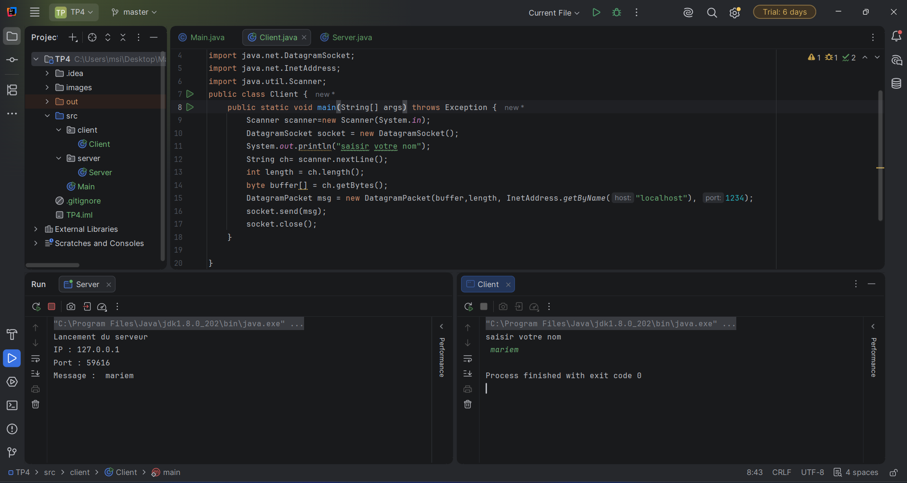
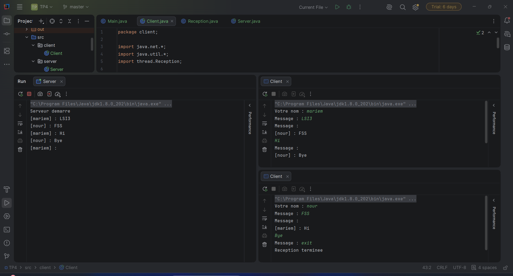

# TP4 : Communication UDP en Java

## 1. Présentation

Ce TP a pour objectif de mettre en place une communication réseau en Java en utilisant le protocole UDP. Il permet de comprendre l'envoi et la réception de datagrammes, ainsi que la communication entre plusieurs clients à travers un serveur.

## 2. Objectifs

- Comprendre le fonctionnement du protocole UDP.
- Créer un serveur UDP utilisant le port 1234.
- Envoyer des messages d'un client vers le serveur.
- Afficher l'adresse IP et le port de l'expéditeur.
- Gérer plusieurs clients simultanément.
- Diffuser les messages aux autres clients.
- Utiliser les threads pour envoyer et recevoir des messages simultanément.

## 3. Technologies utilisées

- **Langage :** Java
- **IDE :** IntelliJ IDEA
- **Protocole réseau :** UDP
- **Port serveur :** 1234

## 4. Structure du projet

```text
TP4/
├── src/
│   ├── client/
│   │   └── Client.java
│   ├── server/
│   │   └── Server.java
│   └── thread/
│       └── Reception.java
├── images/
│   ├── cp1.png
│   ├── cp2.png
└── README.md
```

## 5. Description des classes

### 5.1. Server.java

Le serveur écoute sur le port 1234 et reçoit les messages envoyés par les clients.

Ses principales fonctions sont :
- Recevoir les datagrammes UDP.
- Enregistrer les adresses des clients.
- Afficher les messages reçus.
- Diffuser les messages aux autres clients, à l'exception de l'expéditeur.

### 5.2. Client.java

Le client permet à l'utilisateur de saisir son nom et d'envoyer des messages au serveur.

Ses principales fonctions sont :
- Saisir le nom d'utilisateur.
- Envoyer des messages préfixés par le nom, par exemple `[Mariem] : Bonjour`.
- Envoyer plusieurs messages.
- Recevoir les messages diffusés par le serveur.
- Quitter le programme en saisissant `exit`.

### 5.3. Reception.java

Cette classe hérite de `Thread` et permet de recevoir les messages en parallèle de la saisie et de l'envoi des messages.

## 6. Étape 2 : Communication UDP entre un client et le serveur
Le serveur reçoit les messages du client et affiche le contenu du message, l'adresse IP et le port de l'expéditeur.
### Capture 1 : Exécution du etape1
**Résultat attendu :** le client saisit son nom et envoie un message au serveur.


## 7. Étape 3 : Chat UDP avec plusieurs clients
Le serveur enregistre les adresses des clients et diffuse chaque message aux autres clients enregistrés.

### Capture 2:Exécution du etape2
 deux instances du client sont lancées avec des noms d'utilisateur différents.
 **Résultat attendu :** lorsqu'un client envoie un message, les autres clients le reçoivent en temps réel.


## 8. Exécution du projet

1. Ouvrir le projet dans IntelliJ IDEA.
2. Vérifier que le JDK est correctement configuré.
3. Exécuter `Server.java`.
4. Exécuter `Client.java` et saisir un nom d'utilisateur.
5. Lancer une deuxième instance de `Client.java` avec un autre nom.
6. Envoyer des messages depuis les deux clients.
7. Vérifier que chaque message est reçu par les autres clients.
8. Saisir `exit` pour quitter un client.

## 9. Conclusion

Ce TP nous a permis de comprendre le fonctionnement du protocole UDP en Java, la gestion de plusieurs clients et la diffusion des messages à travers un serveur.

L'utilisation des threads permet de recevoir des messages simultanément à la saisie et à l'envoi des messages.